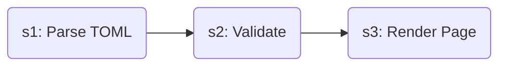
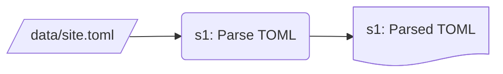
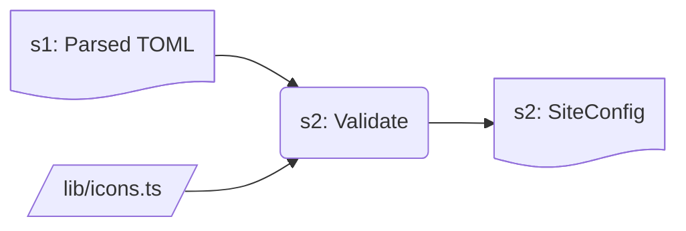
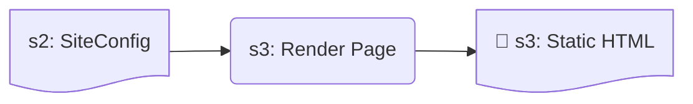

# 文案怎么从 `data/` 走到屏幕上

> 界面上每一句话都住在 `data/site.toml` 里, 前端一个字都不许内联. 这篇讲那条路径的三段:
> **读盘 (server only) -> 校验 (构建期 throw) -> 当 props 传进客户端组件**.

**对应代码**: `lib/site/load.ts`, `lib/site/schema.ts`, `lib/icons.ts`, `data/site.toml`,
`data/business-context.md`

**依赖**: 无. 这是前端依赖图的底, 别的东西都从这里取内容.

---

## 三段路径

一句文案从磁盘走到浏览器要过三步, 每一步交出的东西都有名字.



**s1: Parse TOML** 把人写的文件变成一个未经检查的普通对象. 做这件事的是
`lib/site/load.ts` 的 `loadSite()`, 它**碰文件系统, 所以是 server only**, 而且结果按进程
缓存 —— 同一次构建里问第二次不会再读盘.



**s2: Validate** 是 TOML 换掉 TypeScript 之后补回来的那道关. 两个检查都 **throw**, 所以
`npx next build` 真的会被拦住.



| 检查 | 拦住什么 | 报什么 |
| :--- | :--- | :--- |
| `REQUIRED_SITE_KEYS` | 少一个必填 key | 缺的 key 名 + 文件路径 |
| `assertIconsExist` | `icon` 不在 `lib/icons.ts` 里 | 坏名字 + 全部合法名字 |

不查的后果是静默的: 缺 key 的组件收到 `undefined` 然后在线上渲染成一个空标题; 拼错的图标名
静默渲染成兜底图标 —— 卡片看着好好的, 就是配错了图, 没人会注意到. **`mise run check` 查不到
这两样**, 换完数据集两条命令都要跑.

**s3: Render Page** 由 server component 完成: 它读 `SiteConfig`, 当 props 传给
`"use client"` 的组件. 两个页面都是构建期静态生成的, 所以产物里是烘死的字符串, 请求期不
读盘.



**客户端组件不许自己去读配置**, 因为 `loadSite()` 碰文件系统. 这不是限制, 是边界: 页面是
server component, 它读盘并把结果传下去; `"use client"` 的组件只渲染它拿到的东西.

这条流水线的要点在 `s2: SiteConfig` 这一个产物上: **它是唯一穿过 server/client 边界的东西**,
浏览器里显示的每一个字都来自它, 而它在构建结束的那一刻就冻住了 —— 所以任何"运行时改文案"的
想法在这套结构里都不成立.

---

## 为什么是 TOML 而不是 `.ts`

它以前是 `config/site.ts`, 一个 TypeScript 字面量, 编译器免费帮你查字段和图标名. 改成 TOML
**丢掉了这个**, 换来的是"一个数据集的全部产出集中在 `data/` 一个目录".

权衡的结论是后者更重要: 编译期检查是在**写的时候**帮你, 而目录集中是在**每一次换数据集和
每一次 review** 时帮你. 完整论证见
[architecture/04](../architecture/04-modular-design.md) 第 2 节.

丢掉的检查没有消失, 它们搬到了加载时 —— 就是上面 `s2: Validate` 那一步.

---

## `lib/icons.ts`: 一张显式的图标表

```ts
export const ICONS = { AlertTriangle, BarChart3, ... } satisfies Record<string, LucideIcon>
export type IconName = keyof typeof ICONS
```

**显式列出而不是整包索引 `lucide-react`**, 买到两件事: 打包产物只带真正用到的图标; 而且
`IconName` 有一个精确的来源可以推导 —— 组件里用图标名是类型安全的.

`SiteConfig` 把 `icon` 字段标成 `IconName`, 但值是**从 TOML 经过一次 cast 到达的**, 所以那个
类型是对文件的一个承诺, 不是对文件的检查. 真正的检查是 `assertIconsExist`.

要加图标: 在 `lib/icons.ts` 顶部 import, 加进 `ICONS`. 两步.

---

## `business-context.md`: 原样返回, 只剥注释

```ts
loadBusinessContext()  // -> 原始 Markdown 字符串
```

**故意不解析**: 它由 chat 页那个同一个 Markdown 组件渲染, 所以文件里写 ` ```mermaid ` 围栏
就真的会画出图, 而这一层完全不知道"图"这个概念的存在.

唯一的加工是**剥掉 HTML 注释**. 这是补过的一个真 bug: `react-markdown` 没装 `rehype-raw`,
所以它不解释 HTML —— 它把 `<!-- 给下一个作者的说明 -->` 原样打印成覆盖层里的一段正文.
在这里剥掉, 而不是禁止在文件里写注释, 是为了让作者批注留在有用的地方.

---

## TOML 的一个坑

**一旦开始 `[[...]]` 数组表, 后面每个裸 key 都属于该数组的最后一个元素.** 所以每一节的普通
字段必须写在 `[[...]]` 之前.

写反了不报错, 只会静默错位 —— `site.toml` 顶部的注释专门写了这条.

---

## 那次把文案内联进组件的事故

`[chat.messages] welcomeMessage` 的值是一句完整的话:

```toml
welcomeMessage = "I'm here to help you with SMB lending analytics."
```

而 `chat.tsx` 在渲染时又包了一层句子框架:

```jsx
I'm here to help you with{" "}<span>{site.chat.messages.welcomeMessage}</span>.
```

屏幕上印出来的是 **"I'm here to help you with I'm here to help you with SMB lending
analytics.."** —— 句子重复, 外加两个句号.

**这就是"组件里不许出现业务文案"那条规矩存在的理由**, 而且它示范了这类 bug 的特征: 不报错,
不失败, 测试全绿, 只有真的打开页面读那一行的人才会发现. 现在框架删掉了, 值是一句完整的话,
`site.toml` 里也加了注释说明它必须是完整句.
