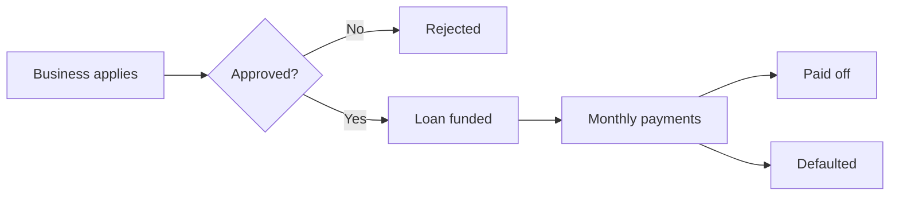

<!--
The long-form explainer behind the home page's one-paragraph pitch.

Opened from the home page and dismissed again without navigating. It exists
because a headline and one paragraph cannot carry a whole business domain, and
a reader who does not already know the industry will otherwise not understand
what any of the agent's answers are for.

It describes the **app**, not the dataset. What ships outward looks like a
dataset with an agent attached, but what a reader actually needs is what the
app is for: whose problem it solves, on what evidence, and how far it goes
today. The first three sections explain the world, the last three explain what
the agent does in it.

Written for a stranger with no domain knowledge and no context about who built
this: the industry, not an employer; the problem, not a project. Common sense
should be enough to follow every sentence.

The title and subtitle above it live in `site.toml` under
`[home.businessContext]`, because they label the control that opens this.

At most one mermaid diagram in the whole file, under ten nodes.
-->

## How a small-business lender makes money

The model is simple enough to state in a sentence: raise money at one rate, lend it to small businesses at a higher one, and keep the difference. A bakery wants $80,000 for a second location, the lender funds it, and the business repays a fixed amount every month for a few years.

What makes it hard is that the difference is thin and the downside is total. Interest on a healthy loan earns a few percentage points a year; a loan that is never repaid loses most of the principal at once. So the business does not really run on how much it lends. It runs on how accurately it can price the chance of not being repaid.

- **Interest.** The main revenue line, charged as an annual rate on the outstanding balance. The rate is set from the borrower's risk grade, which is assigned from their credit profile at the time of approval.
- **Origination fees.** A one-time charge when the loan is funded. Smaller than interest, and earned whether or not the loan is repaid.
- **Defaults.** The dominant cost. When a borrower stops paying, the lender pursues what it can recover and writes off the rest. One default can erase the interest earned on a dozen healthy loans.

## Where the money quietly leaks

None of the following show up as a line item on a financial statement. Each one is structural, a consequence of how lending is normally run, and each stays invisible unless somebody deliberately goes looking. That is what this agent is for.

- **Pricing rests on an assumption nobody re-checks.** Each risk grade is priced against an assumed default rate, set when the grading system was designed. Reality drifts. If a grade was priced for six percent losses and is running near ten, every loan written in that grade is underpriced. And because the loans are performing when they are written, nothing signals the problem for a year or more.
- **Concentration accumulates without anyone choosing it.** No committee ever decides to put a sixth of the book into restaurants. It happens one approval at a time, each defensible on its own. The risk is that loans in one industry do not fail independently. A bad season hits all of them together, which is exactly the scenario a portfolio is supposed to be spread against.
- **The warning arrives months before the loss.** Borrowers rarely stop paying without a run-up. Payments start landing a few days late, then short of the full amount. Most defaults are preceded by that pattern. But a monthly report that shows only what was collected against what was due will show a loan as current until the month it is not.
- **The best applicants look like the risky ones.** Approval rules are tuned to keep bad loans out, and they succeed partly by turning away good ones. A rejected applicant whose profile is stronger than the average borrower already on the books is revenue the lender declined. The borrower who repays goes on to become a repeat customer, who defaults at roughly half the rate of a first-timer, so the cost of that rejection compounds.

## What that looks like in the data

Every one of those leaks leaves a trace, but never in one place. Proving a grade is underpriced means putting the pricing assumption next to two years of outcomes. Proving a default was foreseeable means putting a loan's schedule next to the payments that actually arrived, in the right order, for the months before it failed.

So the record covers the full lending lifecycle together: the businesses that applied, the applications that were approved and rejected and why, the loans that were funded and their terms, the repayment schedule each one was supposed to follow, every payment actually received, and the defaults with what was ultimately recovered.

It is a fixed snapshot rather than a live feed, which is what makes the same question return the same answer whenever it is asked.

The whole record hangs off one path, and every question in this app is really a question about some step along it:

## What the agent does with it

You ask in plain English. The agent reads the database structure, works out which tables have to be joined and at what grain, writes the query, runs it, and then explains what came back in business terms rather than handing you a grid of numbers.

It picks its format to match the question. Exact values arrive as a table. When the shape of the numbers is the point, such as a ranking across grades, a trend across quarters, or a gap between two measures, it draws a chart. When the answer is about how something flows rather than how much, it draws a diagram.

Every number it reports comes from a query it actually ran against the data, not from its own recollection. If you want to check it, ask it to show you the SQL and the reasoning; it keeps both.

## What you can ask, and how to read the answers

Almost every useful question falls into one of four groups. You do not need to phrase them precisely or know any table names.

- **Risk pricing.** Which risk grades are priced for fewer losses than they are actually producing, how wide the gap is, and how much of the book was written inside it.
- **Portfolio concentration.** Which industries hold the largest share of outstanding balance, how their loss rates compare to the rest of the book, and where a single downturn would land hardest.
- **Early warning.** What payment behaviour preceded the loans that defaulted, how far ahead of the write-off it started, and which currently-performing loans are showing the same pattern now.
- **Customer value.** How repeat borrowers compare to first-time ones on default rate and loan size, and whether any rejected applicants had a stronger profile than the average approved borrower.

Two habits make the answers far more useful. First, averages hide the finding: a portfolio-wide default rate is the average of grades that are fine and grades that are not, and it will look reassuring in both cases. Ask for the breakdown, not the mean.

Second, a gap is only actionable with its size attached. A grade mispriced by four percentage points matters differently depending on whether it holds two percent of the book or thirty. The agent will report both together if you ask for them.

## Beyond read-only

This app only reads. It can query anything in the record and explain it, but it cannot change a single row. That is a deliberate choice for something anyone can open, not a limitation of what the approach can do.

The same architecture supports the other half. An agent can be given tools that act rather than only report: flag a loan for collections review, queue a risk grade for repricing at the next committee, open a case on an applicant who looks wrongly rejected. The analysis and the action then live in one place, instead of ending in a slide deck that someone has to act on by hand a week later.

That step is only responsible with two things attached. Guardrails: an agent gets narrowly scoped permissions, and the consequential actions need human approval rather than a broad key and good intentions. An auditable trail: every action it takes is attributable, reviewable, and reversible after the fact. An agent that can act without both is not a more capable product, it is an unaccountable one. That is why what you are looking at here stops at read-only.
