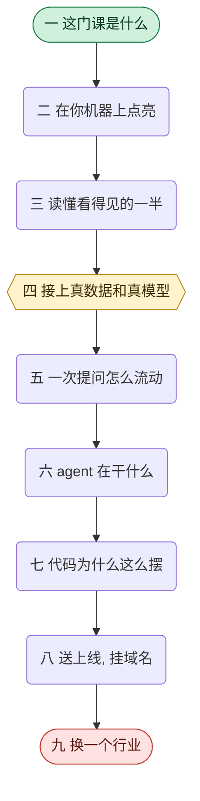

# 这门课的系列索引

这门课教的是**怎么造一个能反复换行业的 AI 数据分析脚手架, 并且守住让它能换的那些边界**.
最后你手上会有一个部署上线, 挂着自己域名, 可以拿去面试的应用.

下面四十二个 Task 分成九块教学内容, 加上三个收尾环节.
**它们不是平铺的, 而是一条做一次, 懂一层, 再做一次, 再懂几层的交替线**:

**做的是第二, 四, 八, 九块; 懂的是第三, 五, 六, 七块.** 每做一次, 后面就跟着几块把刚做的
那件事拆开讲.

**黄色那一块是账号和花钱的唯一一处门槛**: 第四块 (第 13 篇). 在那之前的九篇, 一个账号都不用
注册 —— 这是有意安排的, 让你先跟着走一段, 手上有实感了再去掏卡.

**怎么读**: 按编号顺序走一遍是默认路线. 时间紧就看下面每一块的一句话说明, 挑你最缺的那几块.

---

## 1. 这门课是什么

先弄清楚你要造的是什么, 以及自己缺哪几块前置.

- [02 一个可以换领域, 也能往任何方向深挖的项目](../02-why-this-project/README-cn.md):
  这个项目为什么每一块都只做了一丢丢, 却每一块都留了口子
- [03 开工之前的四门前置课](../03-prerequisites/README-cn.md):
  四道闸门, 会的跳过, 不会的先去补

---

## 2. 先让它在你机器上亮起来

**不注册任何账号, 不填任何真凭据.** 装依赖, 起服务, 首页能看能点就算过.

- [04 和 AI 一起改这个仓库](../04-work-with-ai/README-cn.md):
  后面每一篇都要用的那套派活和验收方法, 所以它排在最前面
- [05 把它跑起来](../05-get-it-running/README-cn.md):
  一个入口 mise, 一份全是占位符的配置, 两个开发服务器

---

## 3. 读懂你看得见的那一半

**这七篇一样账号都不需要**, 读的是磁盘上的文件和浏览器里的静态页面.

- [06 从上往下读一遍这个仓库](../06-read-the-codebase/README-cn.md):
  每个目录归谁管, 以及一次提问的九步长什么样
- [07 教学层和生产层](../07-teaching-and-production/README-cn.md):
  为什么擦掉教学痕迹退化成删几个目录
- [08 从你看得见的东西, 找到看不见的代码](../08-app-router-and-shells/README-cn.md):
  一个三步法, 从屏幕上一块东西倒推到它的文件
- [09 界面上每一句话都住在一个文件里](../09-copy-lives-in-one-file/README-cn.md):
  文案的那条管线, 和两个构建期检查
- [10 首页要把一个外行带到能提第一个问题的位置](../10-the-home-page/README-cn.md):
  首页必须做到的四件事
- [11 agent 页: 空状态不能是空的](../11-the-agent-page/README-cn.md):
  那十二个按钮为什么是橱窗而不是问题列表
- [12 一段纯文本怎么变成表格, 流程图和图表](../12-render-text-into-blocks/README-cn.md):
  前端那个分发点, 以及为什么失败是正常路径

---

## 4. 接上真数据和真模型

**整门课唯一一次真正的门槛.** 这一篇是纯操作, 原理全在后面几块.

- [13 接上真数据和真模型](../13-light-it-up/README-cn.md):
  注册供应商和 Neon, 填真凭据, 造种子, 同步, 然后整个应用活过来

---

## 5. 一次提问在系统里怎么流动

保持在高处看. 你只要能说出数据从哪来, 问题往哪走, 答案怎么回来.

- [14 一个数据集里到底装着什么](../14-what-a-dataset-is/README-cn.md):
  五份源文档, 以及产物为什么不进 Git
- [15 把种子发布到 PostgreSQL](../15-seed-to-postgres/README-cn.md):
  同步做了什么, 隔离为什么用 schema
- [16 前后端分离, 和这个项目是怎么接线的](../16-wire-next-to-fastapi/README-cn.md):
  两个本地进程怎么说话, 以及线上没有这套东西
- [17 协议的力量, 以及这个项目用了它的哪一小块](../17-the-ai-sdk-protocol/README-cn.md):
  进来的请求体和出去的那条事件流

---

## 6. agent 到底在干什么

**最长的一块, 十一篇.** 顺序按一次提问的数据链路排: 先认识它要查的东西, 再认识模型这一侧,
然后一个工具一个工具往上装.

- [18 读懂这个库: 十张表是怎么串起来的](../18-read-the-schema/README-cn.md):
  这个数据集里埋着的那个故事
- [19 用业务问题学 SQL](../19-sql-by-business-question/README-cn.md):
  三个由浅入深的真问题
- [20 直接和模型说话](../20-call-the-model-directly/README-cn.md):
  不带任何框架, 三家 SDK 的最小调用
- [21 多轮对话和 prompt caching](../21-multi-turn-and-caching/README-cn.md):
  一段对话到底是谁在存
- [22 把库结构压给模型看](../22-encode-the-schema-for-llm/README-cn.md):
  反射, 建模, 编码这三步单向
- [23 你的第一个 agent](../23-your-first-agent/README-cn.md):
  一个方法怎么变成工具, 以及说明就是接口
- [24 SQL 工具: 只读是怎么保证的](../24-the-sql-tool/README-cn.md):
  靠事务永远回滚, 不靠关键词黑名单
- [25 系统提示词: 把领域知识灌进去](../25-the-system-prompt/README-cn.md):
  什么必须写, 什么该相信模型知道
- [26 最后一条消息不一定是答案](../26-explain-the-reasoning/README-cn.md):
  从一串消息里挖出思考和答案
- [27 写操作: 为什么默认一个都没有](../27-write-operations/README-cn.md):
  以及真要加的话那三条约束
- [28 一次 chat 请求, 从头到尾](../28-one-chat-request/README-cn.md):
  把整条链路串一遍, 加六个踩出来的决定

---

## 7. 这些代码为什么这么组织

走完一次链路之后才有资格问这个. **这六篇讲的全是不这么做会静默地坏在哪里.**

- [29 那一个对象](../29-the-one-object/README-cn.md):
  四个 mixin 加用到才建, 后端唯一的组装点
- [30 配置: 一个值是怎么走到代码里的](../30-configuration/README-cn.md):
  两个配置文件按是不是密钥切, 而不是按环境切
- [31 没有一个测试连网](../31-tests-without-network/README-cn.md):
  三类外部依赖, 三种换掉的手段
- [32 内容也会错, 而且一样不报错](../32-content-checks/README-cn.md):
  四项内容检查, 以及判不了的时候用顺序代替检查
- [33 花费上限: 谁在为这些对话付钱](../33-the-spend-cap/README-cn.md):
  开关住在哪, 计量坏了该放行还是拒绝
- [34 渲染契约: 三样东西必须同时对上](../34-the-rendering-contract/README-cn.md):
  唯一一篇横跨前后端的内容

---

## 8. 把它送上线, 挂上你自己的域名

从这里开始, 这个项目才存在于你自己电脑之外.

- [35 把它送上公网](../35-deploy-to-vercel/README-cn.md):
  三层配置在云上各走哪条路, 以及那个只在云上出现的静默失败
- [36 挂上你自己的域名](../36-your-own-domain/README-cn.md):
  一个名字能挂住你以后所有的作品

---

## 9. 换一个行业, 和它背后的打法

**这门课的落点.** 走完这一块, 你手上就不是一个作品, 是一台能反复长出作品的机器.

- [37 换一个行业](../37-swap-the-dataset/README-cn.md):
  真的换一次, 然后数一数后端被改了几个文件
- [38 换完内容, 再换衣服](../38-redesign-the-frontend/README-cn.md):
  重新设计前端, 以及那三样碰了会不报错地坏掉
- [39 那个打法](../39-the-real-play/README-cn.md):
  投递之前用几个小时做一个专属项目, 外加一套学陌生行业的方法
- [40 从这里往下挖的八条路](../40-go-deeper-by-role/README-cn.md):
  八个岗位方向各自的口子在哪, 以及那条路上资深的人在做什么

---

## 10. 自测: 证明你真的懂了

单独一个环节, 不是教学 Task. 它检验哪些地方你以为懂了其实没懂.

- [41 这个项目自测题](../41-prove-i-get-it/README-cn.md):
  五十道面试式的题, 模拟你 walkthrough 完这个代码库之后面试官开始追问

---

## 11. 排练: 把这个项目讲出来

也是单独一个环节. 它把这个项目变成你能对着别人讲出口的一段话.

- [42 这个项目我是怎么做出来的](../42-how-i-build-this/README-cn.md):
  开场五分钟的固定路线, 七幕完整叙事, 以及被追问时怎么接

---

## 12. 收尾: 学完之后往哪走

整门课的最后一站.

- [43 学到这里, 然后呢](../43-where-to-go-next/README-cn.md):
  回望你手上多了什么, 以及这门课刻意没覆盖的那几块在哪

---

## 13. 小结

这九块合起来是一条线: 先跑通, 再读懂界面; 接上真数据, 再从外到内把后端拆开; 拆完之后送上线,
最后换一个行业验证前面那些边界是真的.

**走完你能得到三样东西.** 一个部署在自己域名上的完整应用; 一套能反复换行业的脚手架, 而且你
知道它凭什么能换; 以及一份讲得出口的经历 —— 后面那两个收尾环节 (自测和排练) 就是用来把它
变成你真的能拿出去说的东西的.
