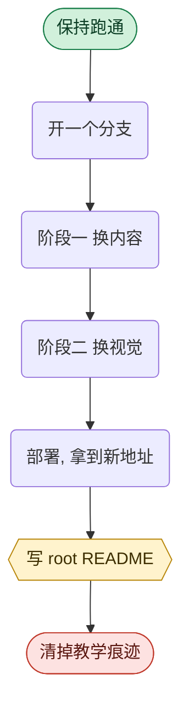

# 换完内容, 再换衣服

> 每一句话都换过了, 但它还穿着上一个行业的衣服. 这一篇讲这一步的力度可以有多大, 以及哪三样
> 东西碰了会不报错地坏掉.

## 1. 概览

上一篇做完, 这个应用的每一句话都已经在讲产科病房排班了. 但你点开它, 看到的还是一套为放贷
业务挑的颜色, 一个为放贷业务排的首页.

**那不是没做完, 那是预期结果.** 换数据集被拆成两个阶段, 上一篇是内容, 这一篇是视觉.

这一篇的分寸感很重要, 因为它两头都容易走偏:

- 一头是**做得太少**: 把主色从蓝换成绿, 别的原样不动. 那等于没做
- 另一头是**动错了地方**: 为了改好看, 顺手重写了几个组件, 结果坏了三样不报错的东西

所以这一篇讲两件事: **力度可以有多大**, 和**边界具体在哪**.

### 卡住了怎么办

这一篇最容易卡的地方是构建突然失败 (十有八九是图标名字), 或者改完之后某个页面还是旧的样子.
**这些都很正常** —— 视觉相关的文件散在十几个地方, 漏掉一两个是常态.

**别自己硬猜, 也别只把报错扫一眼就跳过去.** 把下面三样东西一起给 AI, 一样都别少:

| 给什么 | 怎么给 |
| :--- | :--- |
| **你在读哪一篇** | 原样给路径: `examples/38-redesign-the-frontend/README-cn.md` |
| **你敲了哪条命令** | 原样复制那一行, 不要凭记忆转述 |
| **终端打了什么** | **把终端里的文字整段复制粘贴给它**, 不要截图, 也不要只说一句构建失败了 |

这一篇还多一样特别有用的: **页面截图**. 视觉问题用文字描述很费劲, 一张图省十句话.

一段可以照抄的开场白:

```text
我在读 examples/38-redesign-the-frontend/README-cn.md 这一篇.
我在做换数据集的阶段二.
我敲的命令是:
(把命令粘在这里)
终端打出来的是:
(把完整输出粘在这里)
我另外附了一张页面截图.
帮我判断是哪一步出了问题. 一步一步来, 每一步等我做完再往下.
```

**粘贴之前先打码.** 截图里如果带着地址栏, 注意别把只有你能访问的地址露出去.

---

## 2. 学习目标

学完这个 Task, 你将能够:

1. 说清视觉为什么值得单独一个阶段, 以及为什么建议清空上下文之后再开
2. 用一句话把一个行业的调性说出来, 并说清那句话该覆盖哪几件事
3. 说出那个管视觉的 skill 在仓库里的哪两个位置, 没加载会得到什么样的页面, 以及怎么确认它
   真的进了上下文
4. 判断一个改动是在允许的力度之内, 还是碰到了那三样的边界
5. 说出那三样东西各是什么, 以及重写它们分别会坏掉什么而且不报错
6. 解释深色主题为什么要换掉浅底本身, 而不是补一套暗色变体
7. 说清换完之后为什么还要写一份 root README, 以及它的两条硬约束是什么
8. 复述从保持跑通到清掉教学痕迹那七步, 并说清为什么要留两个 repo

---

## 3. 前置知识

- 完成第 37 篇 ([换一个行业](../37-swap-the-dataset/README-cn.md)), 阶段一已经过了闸门,
  网站功能正常
- 完成第 12 篇 ([把文本画成块](../12-render-text-into-blocks/README-cn.md)) 和第 34 篇
  ([那份横跨前后端的契约](../34-the-rendering-contract/README-cn.md)). 这一篇的边界里有一条
  直接建立在那份契约上
- **在同一个分支上继续做**, 不用另开. 阶段一和阶段二是同一件事的两半

**不需要会写 React, 也不需要装任何东西.** 那个管视觉的 skill 这个仓库自带一份, 已经提交进
git 了 —— 第 7 节说它在哪.

**开工之前先清空上下文.** 下一节讲为什么.

---

## 4. 你将学到什么

- 一个长流程为什么值得在中间清一次上下文, 而这跟模型怎么工作有关
- 定调性这件事该怎么做才不会变成挑一个好看的颜色
- **这一层你不用会写 React**, 以及不会写的情况下你该负责哪三件事
- 一条很实用的判断标准, 用来判断一次重新设计到底做没做
- 三样只许换外观不许换内部的东西, 以及每一样重写之后的具体症状
- 两条会静默失效的样式约束: 一条让你的颜色永远渲染不出来, 一条让两级圆角变成同一个值
- **换完之后最容易漏的那一步**: 那份还在讲上一个行业的 root README
- 整条线的七步, 以及最后那一步为什么不可逆, 所以你需要两个 repo

---

## 5. 为什么视觉要单独一个阶段

有两个理由, 一个关于你, 一个关于模型.

**关于你的那个: 中间需要一次验收.** 阶段一改的是内容, 而内容对不对只有人能判断 —— 第 37 篇
第 6 节讲过那个全程撒谎的状态, 没有任何自动检查抓得住它. 如果视觉和内容一起改, 你验收的时候
会被一堆新颜色分散注意力, 很难专心去读那 12 个问题问得对不对.

**关于模型的那个: 上下文.** 阶段一结束时, 对话里塞满了源文档的段落, 提示词的草稿, 十几轮
文案修改. 那些东西对视觉设计一点用都没有, 但它们还占着位置, 而且会持续影响模型的注意力.

**所以阶段二值得 `/clear` 之后再敲.** 该知道的东西全部在文件里 —— 提示词在磁盘上, 文案在
磁盘上, 数据在数据库里 —— 清空对话不丢任何东西, 只是让视觉设计拿到一个干净的开头.

> 这一条和第 37 篇讲的为什么是两条命令是同一个道理的两面.
> 那一面说的是**一个长 skill 的后半段会被压缩掉**,
> 这一面说的是**一段长对话的前半段会拖住后半段**.

---

## 6. 先定调性, 再动手

这是这一篇最容易被跳过, 而跳过之后一定会返工的一步.

**调性要从这个行业的观感来, 不是从你的个人偏好来.** 干这一行的人每天盯着的屏幕长什么样?
交易台是暗的, 医疗系统是冷白的, 行业刊物是纸白的, 播控室是黑的.

**先用一句话把调性说出来, 再去挑颜色和构图.** 反过来做会得到一堆好看但互相不认识的色块.

那句话至少要覆盖五件事, 缺一件就等于没定:

| 维度 | 要说清什么 |
| :--- | :--- |
| 情绪 | 一个词. 稳重 / 锐利 / 温和 / 精密 |
| 底色 | 浅底还是深底 |
| 主色 | 一个主色加一个强调色, 并说清它为什么是这个行业的颜色 |
| 排版气质 | 字体的性格, 以及标题和正文的对比度 |
| **构图** | 首页那四条业务主线**换成什么形状**. 这一条最容易漏 |

最后一行是分水岭. 前四行都定了而构图没定, 结果就是换了颜色的同一个页面.

**定下来之后, 把那句话写成注释放在 [`tailwind.config.ts`](../../tailwind.config.ts) 顶上.**
下一个人需要知道的不是某个色值是什么, 而是**为什么是它** —— 一个色值人人看得见, 一个理由
只存在于当时那次对话里.

**还有一件事: 别凭记忆配色.** 阶段二那条命令会加载两个专门的 skill, 一个管视觉方向和排版,
一个管图表色板 —— 图表那一套尤其不该拍脑袋, 因为它要同时满足区分度和无障碍对比度.
**下一节讲它们是什么, 没加载会怎样, 以及怎么确认它们真的生效了.**

---

## 7. 别凭记忆配色, 也别自己上手改

这一节讲两件事, 而它们其实是同一件: **这一层你不该自己硬干, 但你得知道怎么盯着它.**

### 那条命令背后加载了一个 skill

阶段二那条命令做的第一件事, 是加载一个叫 `frontend-design` 的 skill. 它是一份关于视觉方向,
排版, 层级和取舍的指南 —— 和第 37 篇第 7 节讲的那种 skill 是同一个东西: 一份写给 AI 的
Markdown 文档, 敲一条命令就整份进对话.

**它没加载会怎样?** 不报错, 页面照样出得来. 但你会拿到一个**长得像所有 AI 生成页面** 的东西:
一个居中的大标题, 一排圆角卡片网格, 一个蓝紫渐变, 一套等宽的间距. 每一样单独看都没问题,
合起来就是模板默认值的味道 —— 而这恰恰是第 8 节那句判据要挡掉的东西.

**它在哪, 要不要安装?** 不用装, **这个仓库自带一份, 而且提交进 git 了**:

| 位置 | 给谁读 |
| :--- | :--- |
| [`.claude/skills/frontend-design/`](../../.claude/skills/frontend-design) | Claude Code 从这里发现 skill |
| [`.agents/skills/frontend-design/`](../../.agents/skills/frontend-design) | 同一份的另一个副本, 给别的 agent 工具用 |

**同一份内容放两处**, 是因为不同的 agent 工具约定的目录名不一样. 你 clone 下来就都有了.

**怎么确认它真的生效了?** 别问 AI 你加载了吗 —— 它几乎总是说加载了. 换个问法, ** 让它复述
一条那份文档里的具体主张**:

```text
你刚加载的 frontend-design 里, 关于字体和排版给了哪几条具体建议?
只说那份文档里写的, 不要说你自己的经验.
```

答得出具体内容就是真进了上下文; 答的是一堆放之四海而皆准的设计常识, 就是没进.

**万一你的工具确实找不到它** (换了个 agent 工具, 或者目录约定不一样), 兜底办法非常朴素:
**直接把那个 `SKILL.md` 的全文粘进对话**. 一个 skill 本来就只是一份 Markdown, 进了上下文
就生效, 那条斜杠命令只是替你省了复制粘贴.

改图表配色那一步还会加载另一个叫 `dataviz` 的 skill. 同样的道理, 同样的确认办法.

### 这一层的文件, 你多半改不来, 而这没关系

现在说一件这门课一直很坦白的事.

**视觉这一层是十几个 React 组件, 加一套 Tailwind 配置, 加一个全局 CSS.** 如果你不是做前端
的, 你打开那个首页组件大概率认不出该动哪一行 —— 而这门课**从来没打算教你 React**, 第 8 篇
和第 10 篇都明说过这一点.

**所以这一步的正确姿势不是自己动手, 是带着 AI 动手.** 你的分工是:

| 谁 | 负责什么 |
| :--- | :--- |
| **你** | 定调性那句话, 判断力度够不够, 守住第 9 节那三样边界, 拿那张单子逐页验收 |
| **AI** | 找到那十几个文件, 改 class, 改配色变量, 改布局结构 |

**这三件你负责的事, 没有一件需要你会写 React.** 它们需要的是你知道这个应用该长什么样, 知道
哪里碰不得, 以及愿意一页一页点过去看.

派活的时候有一个很管用的要求, 值得写进你给 AI 的话里:

```text
一次只改一组文件, 改完停下来告诉我改了哪几个, 让我先看一眼再往下.
不要一次把十几个文件全改了.
```

**理由和第 4 篇那套派活方法是同一条**: 一次改十几个文件, 出了问题你不知道是哪一处引起的;
一次改一组, 你每一步都能回头.

> **这一节和第 37 篇第 7 节说的是同一件事**: 你不是那个逐行改代码的人,
> 你是那个**给方向和做验收** 的人. 区别只在于, 上一篇你交出去的是一致性这种机械活,
> 这一篇你交出去的是一门你没学过的手艺.

---

## 8. 力度: 重新设计, 不是换皮

**默认按大刀阔斧来.** 你敲那条命令的意思是给这个应用一张属于它这个行业的脸, 不是把蓝色换成
绿色.

允许而且鼓励做的:

- **重排首页布局.** 居中窄栏改成左右分栏, 四张能力卡改成带编号的清单或者一条时间线, 眼睛
  最先落在哪 —— 这些都可以重来
- **换整套配色和字体**, 包括从浅底换到深底
- **加这个行业特有的元素**: 一条状态流转的示意, 一组关键指标的排布, 一个这一行的人一眼认得
  的视觉隐喻
- **重写首页那个 Hero 的结构**, 而不是只改它的 class

判断标准就一句:

> **换个颜色再把原来的卡片网格原样搬过来, 等于没做.**

构图本身要是从这个行业里长出来的.

**但视觉的文件散在十几个地方, 而且首页只是其中一个.** 最典型的失败是首页改得很漂亮, 点进
agent 页面还是旧配色. 下面这几处是最常被忘掉的:

| 忘掉的 | 文件 |
| :--- | :--- |
| 能力卡和概念气泡 | [`components/CapabilityCard.tsx`](../../components/CapabilityCard.tsx), [`components/ConceptTooltip.tsx`](../../components/ConceptTooltip.tsx) |
| 业务说明弹窗 | [`components/BusinessContextModal.tsx`](../../components/BusinessContextModal.tsx) |
| agent 页的空状态 | [`components/chat/overview.tsx`](../../components/chat/overview.tsx) |
| 那 12 张 kickstart 卡片 | [`components/chat/multimodal-input.tsx`](../../components/chat/multimodal-input.tsx), [`components/chat/RenderBadge.tsx`](../../components/chat/RenderBadge.tsx) |
| 对话气泡 | [`components/chat/message.tsx`](../../components/chat/message.tsx) |

**还有一个会直接让构建失败的坑**: 换图标的时候, 从图标库挑的新名字必须同步注册进
[`lib/icons.ts`](../../lib/icons.ts). 不注册的话 `mise run build-web` 当场报错 —— 这是第 9 篇
讲过的那两个构建期检查之一, 而且它报的是坏名字加全部合法名字的清单, 照着填就行.

---

## 9. 三样只许换外观, 不许重写

上一节说力度可以很大. **这三样是那个力度的边界**, 理由都一样: **它们坏了不报错.**

**第一样, [`components/chat/`](../../components/chat) 那套对话本身.** 里面装着流式传输,
草稿状态, 错误处理, 自动滚动. 换配色, 换气泡形状, 换排布都可以; 但别碰它的状态逻辑 ——
重写一遍它, 就是重写一遍那些流式的 bug, 而且是在你自己看不出来的地方.

**第二样, 块渲染那一层.** 也就是 [`components/chat/blocks/`](../../components/chat/blocks)
和 [`markdown.tsx`](../../components/chat/markdown.tsx). 这两个是那份跨前后端契约的一半,
另一半在提示词和那 12 个问题的配额里 —— 第 34 篇整篇都在讲它.

自己写一套围栏分发会怎样? **`mise run cli-check-content` 会一路全绿地校验一个已经不成立的
承诺.** 检查看的是提示词和配额那两半, 它根本不知道第三半被换掉了.

**第三样, 气泡和弹窗.** 也就是 [`ConceptTooltip`](../../components/ConceptTooltip.tsx)
和 [`BusinessContextModal`](../../components/BusinessContextModal.tsx). 这两个的外观随便改,
但它们内部有一串你看不见的东西: 悬停, 键盘聚焦, 触屏点按, Escape 关闭, 屏幕阅读器要用的
关联属性, 焦点转移, 滚动锁定. **重写一遍通常是重写坏一遍, 而且用鼠标点两下完全看不出来.**

**另外还有一样不许动: `data/` 里的文案.** 那是阶段一的产物. 阶段二只改它长什么样, 不改它
说什么. 真觉得某句话该改, 单独提出来, 别顺手改掉 —— 顺手改掉就等于在那条推导链上开了一个洞.

---

## 10. 两条会静默失效的样式约束

这两条都属于**写了没用, 而且不报错** 那一类, 所以单独拎出来.

### 要深色就换掉浅底本身

一个很自然的做法是: 保留现在的浅色, 再给每个容器补一套暗色变体, 于是同时支持两种.

**在这个项目里那样做等于什么都没做.** 因为这里没有主题切换的机制 —— 没有配置策略, 没有开关,
没有任何地方会给页面打上那个标记. 那套暗色变体**永远不会被渲染出来**, 因此也永远不会被验证.

代价是双份的: 每个容器的类名长一倍, 而其中一半是没人能看见的猜测.

**正确的做法是改语义本身**: 让那些表示底色和前景色的变量, 从浅底那一套值直接变成深底那一套.
这完全在上一节允许的力度之内, 只是不要走补变体那条路.

### 圆角用现成的刻度, 不要自己派生

现在的圆角是一个阶梯: 行内元素最小, 小控件次之, 内嵌块再大, 卡片更大, 面板最大, 药丸是全圆.
**容器越大圆角越大, 嵌套的时候内圈比外圈紧** —— 这是一个视觉上的层级信号.

有一种常见写法是在配置里用一个基准值减几像素派生出各级圆角. 那样做在这套阶梯上会让相邻的
两级**编译成同一个值**, 于是内嵌块和卡片这一层区分静默消失. 页面看起来还是好的, 只是少了
一层结构.

**这两条的共同点值得记一下**: 它们都不是错误, 是**失效**. 代码在, 意图在, 只是它不产生任何
效果, 而没有任何东西会告诉你.

---

## 11. 还差一步: 那份 root README

阶段二跑完, 应用已经彻头彻尾是新行业的样子了. 这时候最容易发生的事情是: **你觉得完事了.**

没完. 仓库根目录那份 README 还在讲上一个行业, 或者更糟, 还在讲这门课. 而那是别人点开你
GitHub 仓库**第一眼看到的东西** —— 排在你那个漂亮的新首页前面.

**这一步之所以最容易漏, 正是因为应用本身看起来已经好了.**

### 现在写, 不要留到发布那天

理由很实际: 你刚刚花了两三个小时泡在这个行业里, 那些业务名词, 那几条主线, 那个数据集埋着
什么张力, 全都还在你脑子里. 过一个星期再来写, 你得重新读一遍自己的提示词.

### 怎么写

和第 7 节那一层一样, **你给素材和做验收, 让 AI 写初稿**:

| 你负责 | AI 负责 |
| :--- | :--- |
| 这个项目解决谁的什么问题, 你为什么挑那几个业务问题 | 组织结构, 措辞, 排版 |
| 技术栈和跑起来的步骤是否属实 | 把它们写成别人照着能跑通的样子 |
| 通读一遍, 把不像人话的地方划掉 | |

两条硬约束:

- **一千词以内.** 一份读不完的 README 等于没有 README. 目标落在三五百词最舒服, 一千是上限
- **作品口吻, 不是教程口吻.** 绝不出现本课, 本教程, 我们在这门课里, 作为学生这类措辞 ——
  它们会把这个项目从我做的产品一秒钟打回我上过的课

**这一条后面还会被查一遍.** 你最后跑那个清理教学痕迹的 skill 时, 它会拿这几个词去 grep 你的
README; 命中就是高危, 得回来改.

### 这条线整体长什么样

写 README 是倒数第二步. 把整件事串起来是这样:



这张图真正要说的是: **黄色那一步是唯一一个会被打回来的**, 因为它是清理那一步唯一要读内容
而不是删文件的检查项.

### 最后一步会删掉很多东西, 所以你要两个 repo

最后那个清理动作**是不可逆的**: 它会删掉整个 `examples/`, 删掉 `.claude/` 和 `dataset/`,
也就是说**换数据集那套工具本身会跟着一起没**.

所以正确的做法是**留两个 repo**:

| repo | 是什么 | 里面有什么 |
| :--- | :--- | :--- |
| **开发部署用** | 你自己的机器, 永久保留 | 全套. 教学材料, 换数据集的 skill, 数据集源文档, 全在 |
| **demo 用** | 给别人看的那个 | 清理过的成品, 一点教学痕迹都没有 |

第 39 篇讲的那台能反复长出作品的机器, **住在第一个 repo 里**. 第二个是它的产物, 每投一家
公司就长一个新的.

**所以这一整条线是在一个分支上做的**, 名字随你, 比如 `ready-for-swap`. 主分支上那个跑通的
SMB lending 版本原样留着 —— 下一次换行业, 你是从它再分一次, 而不是在换过的那个上面接着换.

---

## 12. 练习

### 练习 1: 真的换一次脸, 然后逐页对账

**目标:** 走完阶段二, 并且确认视觉真的覆盖到了那几个最常漏的地方.

**怎么做:**

1. 先 `/clear`
2. 敲 `/run-swap-dataset-phase-2-cn`, 跟着它走
3. 它会先问你调性. **按第 6 节那五个维度回答**, 特别是构图那一条, 别只给形容词
4. 做完之后跑一次构建:

```bash
mise run build-web
```

5. 起开发服务器:

```bash
mise run dev
```

6. **按下面这张单子逐个看过去**, 每一项确认它是新的样子还是旧的样子:

| 看哪儿 | 怎么到 |
| :--- | :--- |
| 首页整体 | 打开根路径 |
| 四张能力卡 | 首页往下滚 |
| 概念气泡 | 在首页把鼠标停在一个加了下划线的业务词上 |
| 业务说明弹窗 | 首页点那个看业务背景的入口 |
| agent 页空状态 | 进 agent 页, 什么都别点 |
| 那 12 张卡片 | 同上, 看输入框上方 |
| 对话气泡 | 随便问一个问题 |

7. 找出还穿着旧衣服的那几处, 补上

**你会观察到:**

大概率会漏掉一到两处, 而且**几乎总是 agent 页那一侧** —— 因为改首页的时候你一直在看首页.
这就是第 8 节那张表存在的理由.

还要注意第 6 步最后一项: 对话气泡只有在你真的问了一个问题之后才看得到, 所以它是最容易被跳过
的一处.

> **关键洞见:** 一次视觉改动的验收, 不能靠改完之后看一眼. 得有一张**别人写好的单子**, 因为
> 你漏掉的那几处, 正是你想不起来的那几处.

### 练习 2: 判断四个改动落在哪一边

**目标:** 拿到一个改动请求时, 立刻知道它是随便改还是要小心.

**怎么做:**

对下面四个假想的改动, 各回答两件事: **允许还是碰到了边界**, 以及** 如果硬做, 会坏掉什么而且
不报错**.

| 改动 | 允许? | 硬做会坏掉什么 |
| :--- | :--- | :--- |
| 把首页四张能力卡改成一条竖直的时间线 | ? | ? |
| 觉得对话气泡的滚动不够顺, 自己写一套滚动逻辑 | ? | ? |
| 觉得那个概念气泡太朴素, 换成一个自己写的浮层组件 | ? | ? |
| 觉得表格块的样式不好看, 自己写一套围栏解析和渲染 | ? | ? |

答完之后再回答一句总结: 这四个里能不能只靠**运行一次程序** 分辨出哪些出了问题.

**你会观察到:**

第一个是允许的, 而且正是第 8 节鼓励的那种改法. 后三个各自碰到那三样中的一样.

而最后那句总结的答案是**不能**. 第二个的症状是流式过程中偶尔跳一下, 第三个的症状只有用
键盘或者屏幕阅读器的人才会遇到, 第四个的症状是内容检查依然全绿而某类块不再渲染.
**三种都需要你知道去看哪里才看得见.**

> **关键洞见:** 一个组件值不值得重写, 看的不是它有多少行, 是**它内部有多少你看不见的状态**.
> 一个只画方框的组件重写十遍都没事; 一个管着焦点, 键盘和滚动的组件, 重写一遍就是十个新 bug.

---

## 13. 回顾: 我们学到了什么

| 概念 | 一句话 |
| :--- | :--- |
| 为什么单独一个阶段 | 中间要一次人工验收, 而且视觉设计值得拿到一段干净的上下文 |
| 清空上下文 | 该知道的都在文件里, 清掉不丢东西, 只是让注意力重来 |
| 定调性 | 先说成一句话再挑颜色, 那句话要覆盖情绪, 底色, 主色, 排版和构图 |
| 那个 skill | 一份写给 AI 的设计指南, 仓库自带两份副本, 不用安装 |
| 没加载会怎样 | 不报错, 但你会拿到一个长得像所有 AI 生成页面的东西 |
| 怎么确认它生效 | 别问它加载了吗, 让它复述那份文档里的一条具体主张 |
| 你的分工 | 你定调性, 守边界, 逐页验收; AI 动那十几个文件. 你不用会写 React |
| 构图最容易漏 | 前四样都定了而构图没定, 结果就是换了颜色的同一个页面 |
| 力度判据 | 换个颜色再把原来的网格搬回来, 等于没做 |
| 最常漏的地方 | agent 页那一侧, 因为你改首页的时候一直在看首页 |
| 三样的边界 | 对话本身, 块渲染与契约, 气泡与弹窗的交互. 都是坏了不报错 |
| 静默失效 | 补一套永远不会被渲染的暗色变体, 和派生出两级相同的圆角 |
| 该不该重写一个组件 | 看它内部有多少你看不见的状态, 不看它有多少行 |
| 还差的那一步 | 那份 root README. 一千词以内, 作品口吻, 而且清理那一步会拿几个词去 grep 它 |
| 为什么现在写 | 那个行业的细节还在你脑子里. 过一星期你得重读一遍自己的提示词 |
| 为什么要两个 repo | 最后那一步会删掉 `examples/`, `.claude/` 和 `dataset/`, 不可逆. 机器住在开发那个 repo 里 |

---

## 14. 导师寄语

**为什么这一篇值得认真读:**

因为它是这门课里唯一一篇**鼓励你大改** 的内容, 而它同时要求你把手停在三个地方.

这个组合比它听起来更难. 一个只说别乱改的规矩很好守, 一个只说随便改的规矩也很好守. 难的是
同时接受这两句话, 并且能在每一次具体的改动前判断自己站在哪一边.

**而那个判据其实很朴素**: 看这个东西内部有没有你看不见的状态. 颜色, 间距, 圆角, 字体, 布局 ——
这些全都是你看得见的, 改坏了你当场就知道. 焦点, 滚动, 流式, 契约 —— 这些改坏了要过很久,
而且往往是别人替你发现的.

**还有一句想说.** 很多人做到这一步会觉得视觉是最不技术的一环, 可以随便糊一下. 恰恰相反:
这是**唯一一个别人一秒钟就会做出判断的环节**. 你前面三十几篇建立的所有东西 —— 干净的边界,
可靠的检查, 一致的内容 —— 别人一个都看不见, 他看见的是首页那一屏.

**关键洞见:**

- 一段长对话的前半段会拖住后半段, 该清的时候要清
- 调性是一句话, 不是一组色值. 色值可以从那句话推出来, 反过来不行
- 一次视觉验收要有一张别人写好的单子, 因为你漏的正是你想不起来的
- 判断一个组件能不能重写, 看它内部有多少看不见的状态
- 写了不报错也不生效, 是比报错更糟的一种结果

**下一步:**

到这里, 你已经完整地把这个应用换过一次行业了 —— 而且知道每一步为什么是那样, 也知道最后
那两步 (写 README, 清教学痕迹) 该怎么收口. 第 39 篇
([那个打法](../39-the-real-play/README-cn.md)) 讲这套东西真正的用法: 它不是一个作品, 是
一台可以针对每一次投递重新长出一个作品的机器. 顺便还有一层不那么功利的用法.

---

## 15. 速查

**开工:**

```text
/clear
```

```text
/run-swap-dataset-phase-2-cn
```

**验收:**

```bash
mise run build-web
```

```bash
mise run dev
```

**调性那句话要覆盖:** 情绪, 底色, 主色加强调色, 排版气质, **构图**.

**逐页对账的单子:** 首页整体, 四张能力卡, 概念气泡, 业务说明弹窗, agent 页空状态,
12 张 kickstart 卡片, 对话气泡.

**三样只许换外观:**

| 那一样 | 重写之后的症状 |
| :--- | :--- |
| [`components/chat/`](../../components/chat) 那套对话 | 流式偶尔跳一下, 草稿或者错误处理丢了 |
| [`blocks/`](../../components/chat/blocks) 与 [`markdown.tsx`](../../components/chat/markdown.tsx) | 内容检查全绿, 而某类块不再渲染 |
| [`ConceptTooltip`](../../components/ConceptTooltip.tsx) 与 [`BusinessContextModal`](../../components/BusinessContextModal.tsx) | 鼠标用起来正常, 键盘和屏幕阅读器坏了 |

**换图标记得同步注册进 [`lib/icons.ts`](../../lib/icons.ts)**, 否则构建当场失败.

**换完之后还有两步:**

```text
1. 写 root README   一千词以内, 作品口吻, 不许出现本课 / 本教程 / 我们在这门课里
2. 清教学痕迹        不可逆, 所以先确认你的开发 repo 还在
```

**整条线的七步:**

```text
保持跑通 -> 开分支 -> 阶段一换内容 -> 阶段二换视觉 -> 部署 -> 写 root README -> 清教学痕迹
```

**两个 repo:** 开发部署那个永久保留 (机器住在里面), demo 那个是它的产物, 每投一家公司长一个.
